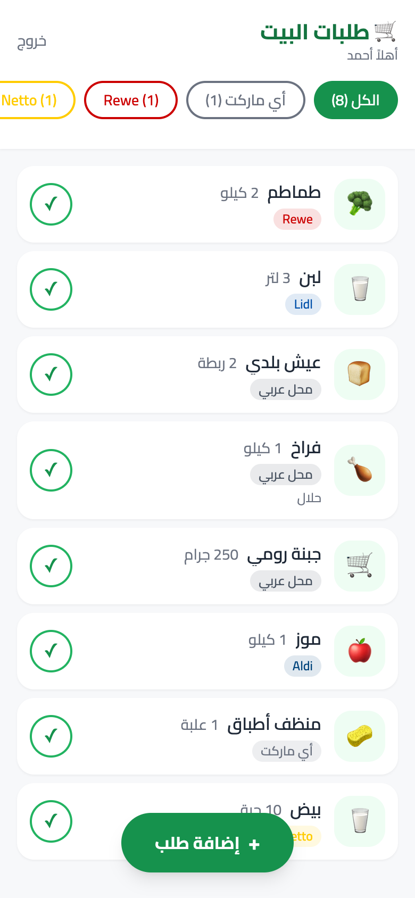
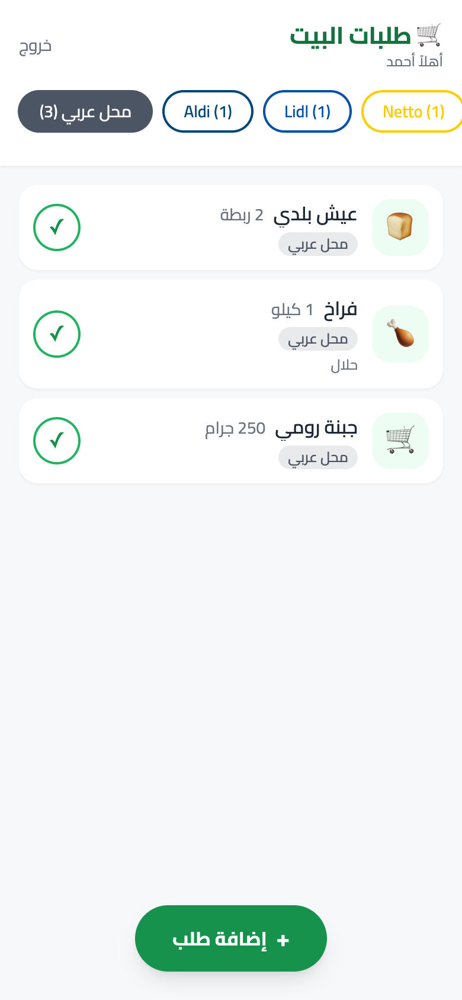
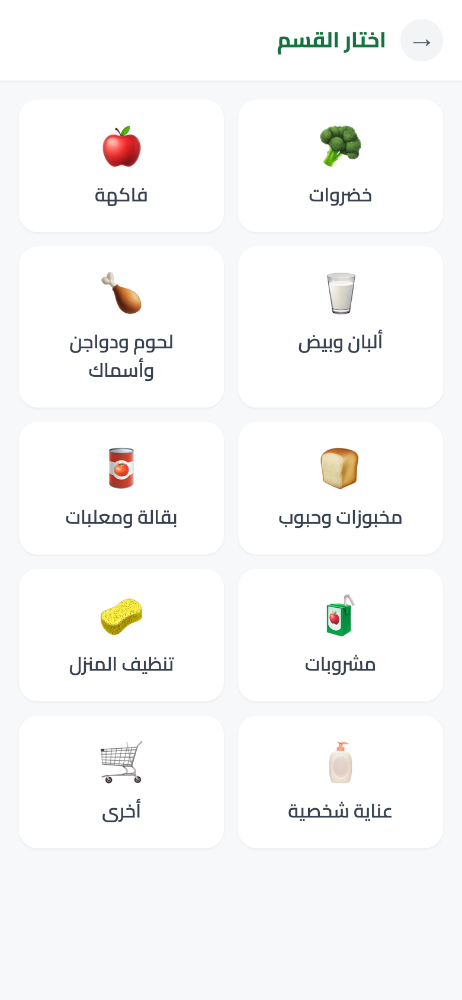
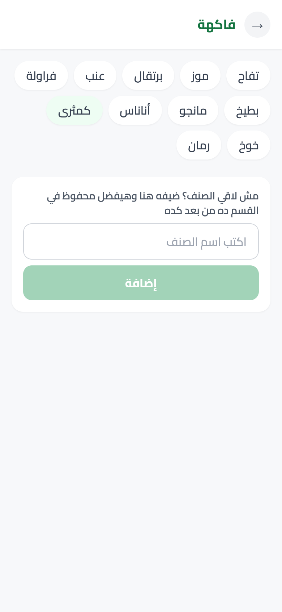
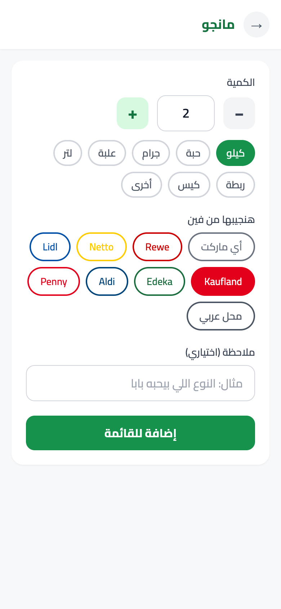
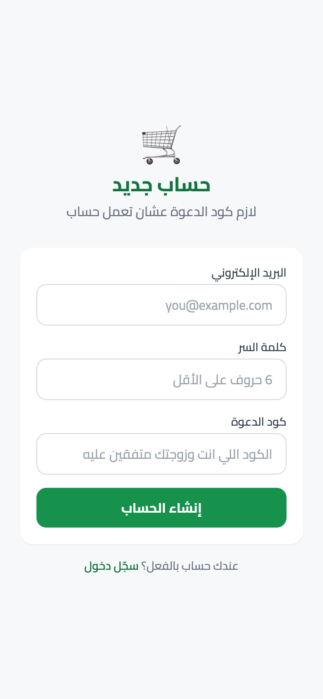

<div dir="rtl">

<div align="center">

# 🛒 طلبات البيت

**قائمة مشتريات واحدة مشتركة للبيت كله**
كل واحد يضيف من موبايله، والتاني يشوفها على طول — ولما تشتري حاجة، دوس ✓ وتختفي من عند الكل.




</div>

---

## ✨ التطبيق بيعمل إيه؟

| | |
|---|---|
| 👥 **قائمة واحدة مشتركة** | كل واحد بحسابه، بس الكل بيشوف نفس القائمة |
| 🥦 **أقسام جاهزة** | خضار، فاكهة، ألبان، لحوم، تنظيف… أو اكتب أي صنف وهيتحفظ في القسم بتاعه للمرة الجاية |
| ⚖️ **كمية ووحدة** | عداد كمية + كيلو / حبة / جرام / علبة / لتر… أو أي وحدة تكتبها |
| 🏪 **اختار الماركت** | Rewe، Netto، Lidl، Kaufland، Edeka، Aldi، Penny، محل عربي، أو "أي ماركت" |
| 🔎 **فلترة بالماركت** | وانت واقف جوه Lidl؟ اعرض طلبات Lidl بس |
| 🔄 **تحديث تلقائي** | القائمة بتتحدث لوحدها كل 12 ثانية ولما ترجع للتطبيق |
| 📱 **زي التطبيقات العادية** | تتضاف لشاشة الموبايل الرئيسية بأيقونة (PWA) |
| 🔒 **خاص بيكم بس** | التسجيل بكود سري، وبيتقفل تلقائيًا بعد عدد الحسابات اللي تحدده |

## 📸 صور من التطبيق

<div align="center">

| القائمة | فلترة بالماركت | اختيار القسم |
|:---:|:---:|:---:|
|  |  |  |
| **اختيار الصنف** | **الكمية والماركت** | **إنشاء حساب** |
|  |  |  |

</div>

---

## 🚀 انشره لنفسك في ~15 دقيقة (مجانًا)

كل اللي محتاجه: حساب **GitHub** وحساب **Vercel** (سجّل في Vercel بحساب GitHub). مش محتاج تنزّل أي حاجة على جهازك.

> 💡 كل نسخة بتتنشر مستقلة تمامًا: قاعدة بيانات لوحدها، حسابات لوحدها، ومحدش يشوف بيانات حد تاني.

### الخطوة 1 — حط الكود على GitHub بتاعك

**لو عندك الـ repo على GitHub:** دوس **Fork** فوق على اليمين، وخلاص.

**لو جالك الكود كملف zip:** فكّه، وبعدين من جوه الفولدر:

```bash
git init
git add .
git commit -m "طلبات البيت"
git branch -M main
git remote add origin https://github.com/<اسم-حسابك>/talabat-elbeet.git
git push -u origin main
```

(اعمل الأول repo فاضي على GitHub باسم `talabat-elbeet` — ويُفضل يكون **Private**.)

### الخطوة 2 — اعمل المشروع على Vercel

1. ادخل [vercel.com/new](https://vercel.com/new) واختار الـ repo `talabat-elbeet` ← **Import**.
2. سيب كل الإعدادات زي ما هي ودوس **Deploy**.

> ⚠️ **أول Deploy هيفشل — وده طبيعي ومتوقع.** لسه مفيش قاعدة بيانات. إحنا محتاجين بس المشروع يتعمل عشان نكمل.

### الخطوة 3 — اعمل قاعدة البيانات (Postgres)

1. من صفحة المشروع على Vercel ← تبويب **Storage** ← **Create Database**.
2. اختار **Neon** (Serverless Postgres) ← الخطة المجانية كفاية جدًا ← اختار أقرب منطقة ليك (مثلًا Frankfurt لو في ألمانيا).
3. اربطها بالمشروع (**Connect**) وسيب كل البيئات (Production / Preview / Development) متعلّم عليها.

Vercel هيضيف لوحده متغيرات كتير، أهمهم:
- `DATABASE_URL` ← ده اللي التطبيق بيستخدمه ✅
- `DATABASE_URL_UNPOOLED` ← محتاجين ننسخه باسم تاني في الخطوة الجاية

### الخطوة 4 — ضيف باقي المتغيرات

روح **Settings ← Environment Variables** وضيف:

| الاسم | القيمة | منين أجيبها؟ |
|---|---|---|
| `DIRECT_URL` | نفس قيمة `DATABASE_URL_UNPOOLED` | افتحها من نفس الصفحة، دوس 👁 وانسخها |
| `NEXTAUTH_SECRET` | نص عشوائي طويل | على ماك/لينكس: `openssl rand -base64 32` — أو أي باسورد عشوائي 32 حرف+ من أي password generator |
| `REGISTRATION_CODE` | كود سري من اختيارك | مثلًا `bamya-2026` — هتديه لأهل البيت بس |
| `NEXTAUTH_URL` | رابط موقعك | من صفحة المشروع على Vercel تحت **Domains**، مثلًا `https://talabat-elbeet-xyz.vercel.app` |
| `MAX_USERS` | عدد الحسابات | اختياري — الافتراضي `2`. لو البيت 4 أفراد خليه `4` |

> 🔑 **ماتستخدمش نفس `NEXTAUTH_SECRET` أو `REGISTRATION_CODE` بتوع حد تاني.** اعمل بتوعك.

### الخطوة 5 — Redeploy 🎉

المتغيرات الجديدة مش بتشتغل غير مع Deploy جديد:

**Deployments** ← آخر deploy ← **⋯** ← **Redeploy**.

المرة دي هيعدّي، وجداول قاعدة البيانات بتتعمل تلقائيًا أثناء الـ build — مش محتاج تعمل أي حاجة يدوي.

### الخطوة 6 — اعملوا الحسابات

1. افتح رابط الموقع ← **"سجّل من هنا"**.
2. اكتب إيميلك، باسورد (6 حروف على الأقل)، والـ `REGISTRATION_CODE`.
3. باقي أهل البيت يعملوا نفس الخطوة من موبايلاتهم.
4. أول ما عدد الحسابات يوصل `MAX_USERS`، التسجيل بيتقفل — محدش تاني يقدر يسجل حتى لو عرف الكود.

> ℹ️ الاسم اللي بيظهر في "أهلاً …" هو الجزء اللي قبل `@` في الإيميل.

---

## 📱 حطه على شاشة الموبايل

<table>
<tr>
<td width="50%" valign="top">

**🍎 آيفون (Safari)**
1. افتح رابط الموقع في **Safari** (مش Chrome).
2. دوس زرار المشاركة ⬆️.
3. **Add to Home Screen / إضافة إلى الشاشة الرئيسية**.

</td>
<td width="50%" valign="top">

**🤖 أندرويد (Chrome)**
1. افتح رابط الموقع في **Chrome**.
2. دوس ⋮ فوق.
3. **Install app / تثبيت التطبيق** أو **Add to Home screen**.

</td>
</tr>
</table>

من بعد كده بيفتح من الأيقونة زي أي تطبيق، من غير شريط المتصفح.

---

## 🛠️ تعديلات سهلة

كل البيانات الجاهزة في ملف واحد: [`lib/data.ts`](lib/data.ts)

| عايز تغيّر… | عدّل |
|---|---|
| الماركتات (اسم ولون) | `STORES` |
| الأقسام والأصناف الجاهزة | `CATEGORIES` |
| الوحدات (كيلو، حبة…) | `UNITS` و `DEFAULT_UNIT` |

وبعد ما تعمل `git push`، Vercel بينشر التعديل لوحده.

---

## 🩺 لو حاجة مش شغالة

| المشكلة | الحل |
|---|---|
| الـ build بيفشل بـ `Environment variable not found: DATABASE_URL` أو `DIRECT_URL` | اتأكد إن الاتنين موجودين في **Environment Variables**، وبعدين **Redeploy** |
| ضفت متغيرات بس مفيش حاجة اتغيرت | لازم **Redeploy** بعد أي تعديل في المتغيرات |
| تسجيل الدخول بيرجعك لصفحة الدخول تاني | `NEXTAUTH_URL` لازم يكون نفس رابط الموقع بالظبط (بـ `https://` ومن غير `/` في الآخر)، و`NEXTAUTH_SECRET` موجود |
| "كود الدعوة غير صحيح" | الكود حساس للحروف الكبيرة/الصغيرة والمسافات. اتأكد من `REGISTRATION_CODE` |
| "تم إنشاء كل الحسابات المسموح بها" | زوّد `MAX_USERS` واعمل **Redeploy** |
| نسيت الباسورد | مفيش reset من التطبيق. من Vercel ← **Storage** ← Neon ← افتح الـ Console وامسح الحساب من جدول `User`، وسجل تاني |

---

## 💻 التشغيل على جهازك (للمطورين — اختياري)

محتاج **Node.js 18+** وقاعدة Postgres. أسهل طريقة بـ Docker:

```bash
# 1) قاعدة بيانات محلية
docker run -d --name talabat-db -e POSTGRES_PASSWORD=pw -e POSTGRES_DB=talabat -p 5432:5432 postgres:16-alpine

# 2) المتغيرات
cp env.sample .env      # .env متجاهل من git، وNext.js وPrisma الاتنين بيقروه
#    وحط في .env:
#    DATABASE_URL="postgresql://postgres:pw@localhost:5432/talabat"
#    DIRECT_URL="postgresql://postgres:pw@localhost:5432/talabat"
#    NEXTAUTH_URL="http://localhost:3000"
#    + أي قيم لـ NEXTAUTH_SECRET و REGISTRATION_CODE

# 3) شغّل
npm install
npm run db:push      # يعمل الجداول
npm run dev
```

افتح http://localhost:3000.

| أمر | بيعمل إيه |
|---|---|
| `npm run dev` | يشغل التطبيق محليًا |
| `npm run db:push` | يعمل/يحدّث جداول قاعدة البيانات |
| `npm run db:studio` | يفتح واجهة تشوف وتعدّل فيها البيانات |
| `npm run build` | نفس اللي Vercel بيعمله: يجهز الجداول ويبني التطبيق |

### بنية المشروع

```
app/
  page.tsx            ← القائمة الرئيسية
  add/                ← خطوات إضافة طلب
  login/ register/    ← الدخول والتسجيل
  api/                ← items, custom-items, register, auth
components/           ← ShoppingList, AddItemFlow
lib/data.ts           ← الماركتات والأقسام والوحدات
prisma/schema.prisma  ← جداول قاعدة البيانات
public/               ← الأيقونات و manifest الخاص بالـ PWA
```

---

<div align="center">

اتعمل بحب لأهل البيت 🏠💚

</div>

</div>
